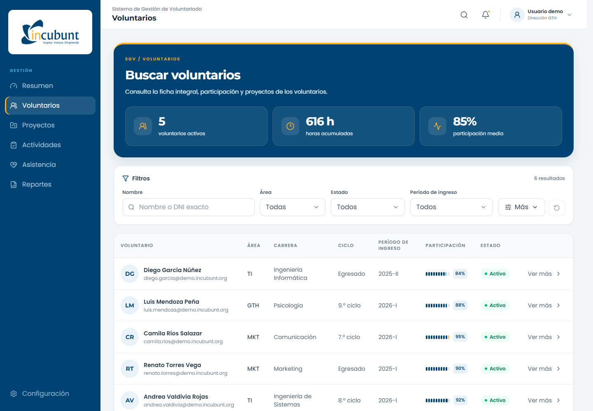

# SGV — Directorio y ficha de voluntarios

Prototipo frontend del Sistema de Gestión de Voluntariado de INCUBUNT. Incluye búsqueda y filtros, ficha integral, métricas de participación y consulta de proyectos.

## Funcionalidades

- Búsqueda por nombre y DNI exacto según el rol.
- Filtros por área, estado, período de ingreso, proyecto y participación.
- Fichas con identificación, datos sensibles, métricas, proyectos y sanciones.
- Vistas simuladas para Presidencia, Dirección GTH y Dirección de área.
- Interfaz adaptable a escritorio, tableta y móvil.

## Vista previa



## Instalación

Requisitos: Git y Node.js 22.12 o superior compatible con Vite 8.

```powershell
git clone https://github.com/OleOle19/sgv-prototipo-frontend.git
cd sgv-prototipo-frontend
npm ci
npm run dev -- --port 5173
```

Abre http://localhost:5173. No requiere base de datos ni archivo de entorno.

## Desarrollo y pruebas

| Comando | Uso |
| --- | --- |
| `npm run dev` | Servidor de desarrollo |
| `npm run verificar` | Revisión estática y compilación |
| `npm run prueba:funcional` | Comprobación de filtros, fichas y roles |
| `npm run prueba:estabilidad` | Comprobación de estabilidad visual |
| `npm run capturas:visuales` | Capturas de escritorio, tableta y móvil |
| `npm run preview` | Vista previa de la compilación |

Las pruebas de navegador requieren el servidor activo en el puerto 5173 y Edge o Chrome instalado.

## Tecnologías y estructura

React, TypeScript, Vite, Tailwind CSS, Radix UI, TanStack Table y Lucide. Montserrat y Poppins se sirven localmente.

```text
src/componentes/  Interfaz y controles reutilizables
src/estructuras/  Navegación y distribución general
src/paginas/      Directorio, ficha y proyecto
src/datos/        Registros y permisos de demostración
src/tipos/        Contratos del dominio
src/utilidades/   Funciones compartidas
public/          Recursos estáticos
scripts/         Pruebas y capturas
docs/            Documentación técnica
```

## Alcance

Los datos son ficticios y los permisos se simulan en el navegador. Esta versión no implementa autenticación, autorización de servidor ni persistencia. No debe utilizarse con información personal real.

## Colaboración

Trabaja en una rama y envía un pull request. Antes de solicitar revisión, ejecuta `npm run verificar` y las pruebas correspondientes. Mantén `main` compilable.

Consulta las [decisiones técnicas](docs/DECISIONES.md) y la [guía de implementación](docs/GUIA_DE_TIPEO.md).

Los [componentes visuales e interacciones](docs/ACTUALIZACION_VISUAL.md) se documentan por separado.
